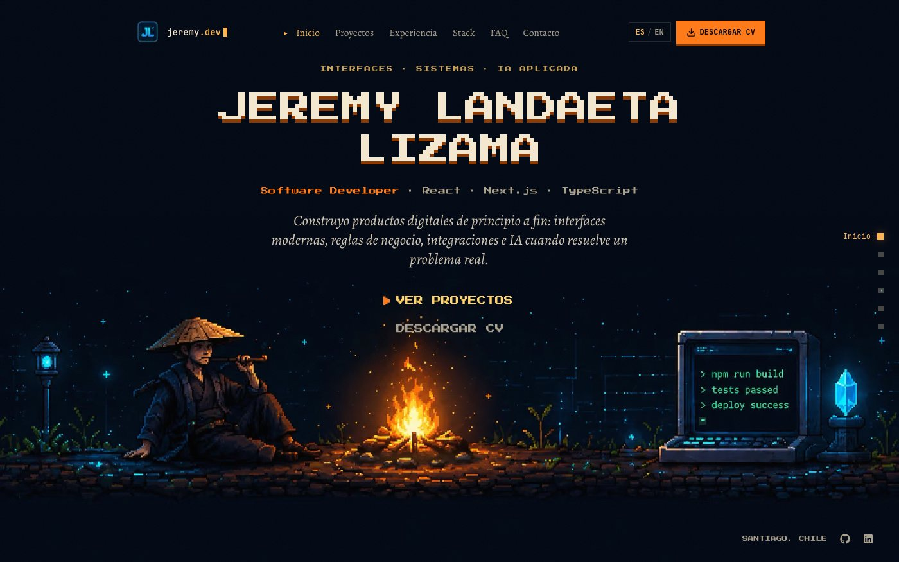
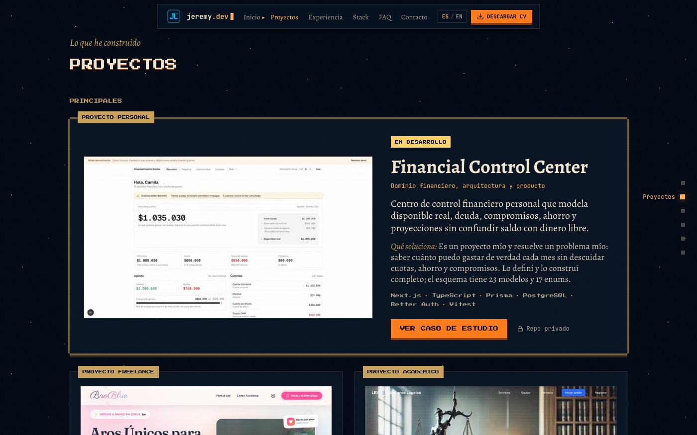
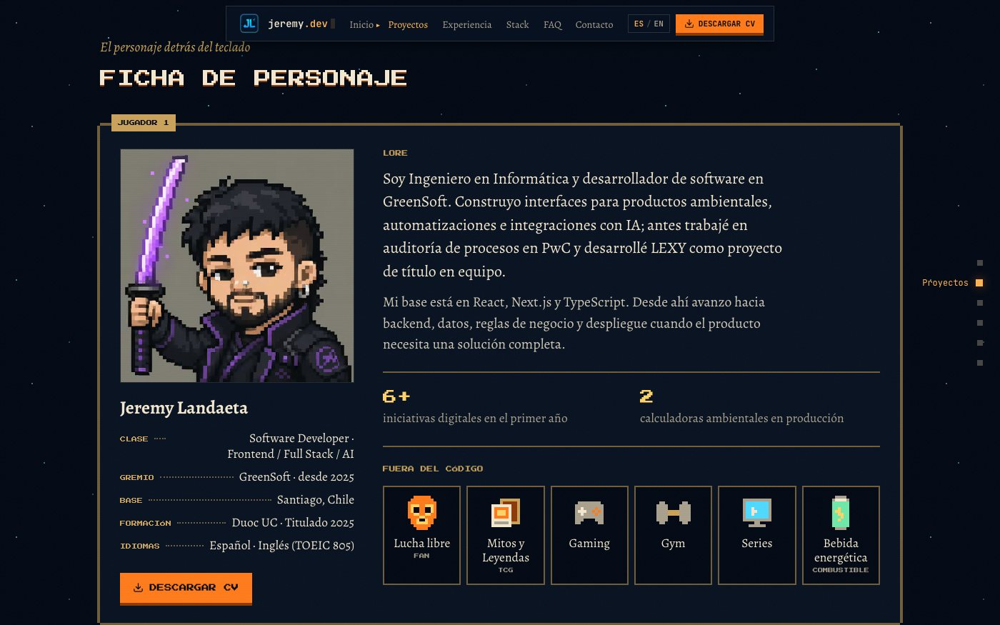
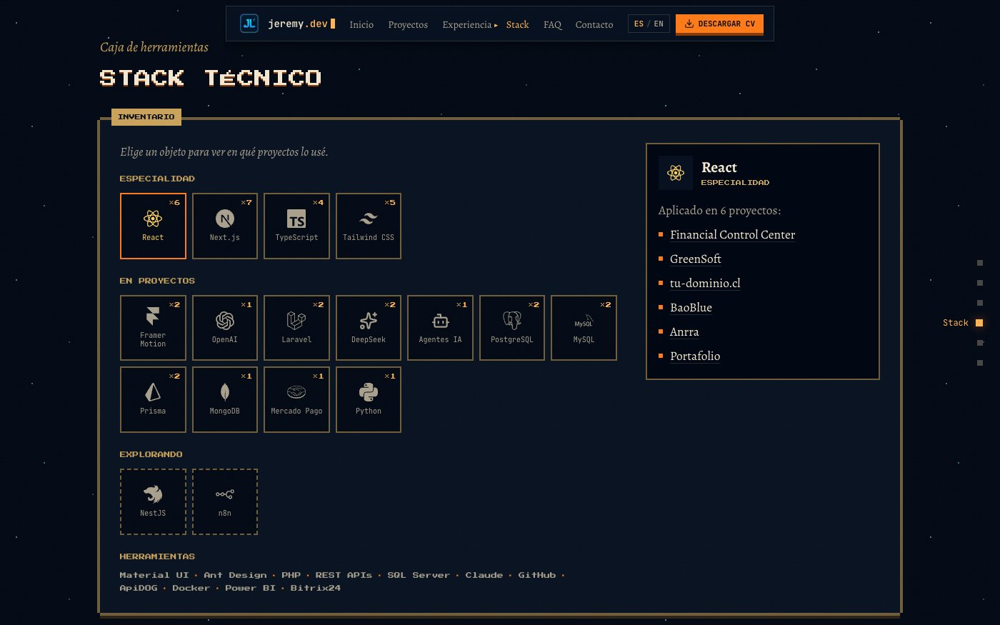
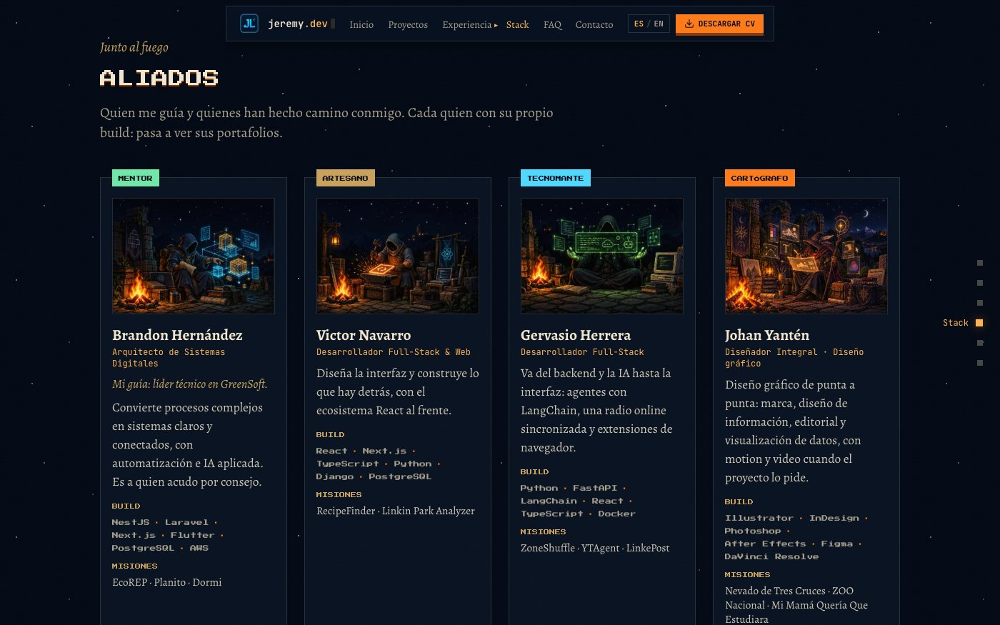
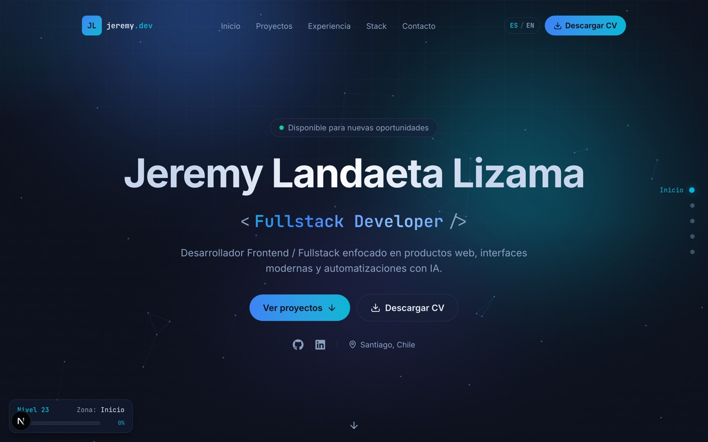

# Portafolio anterior · Jeremy Landaeta

> [!NOTE]
> Esta es la **versión anterior** de mi portafolio y ya no está publicada.
> El portafolio actual está en **[jlandaeta.dev](https://jlandaeta.dev)**.



Portafolio bilingüe (ES/EN) con estética RPG pixel-art, al que llamé "Fogata". Cada sección funciona como una pantalla de juego: la ficha de personaje, el inventario del stack, los logros que se desbloquean al recorrer la página y la party de aliados. Detrás hay un sitio de producción: contenido tipado y validado, SEO completo, accesibilidad y cuidado del rendimiento.

**Stack:** Next.js 16 (App Router) · React 19 · TypeScript · Tailwind CSS 4 · Framer Motion

## Capturas

| Proyectos con casos de estudio | Ficha de personaje |
| --- | --- |
|  |  |
| **Inventario del stack** | **Aliados** |
|  |  |

## Qué hay detrás

- **Contenido tipado y validado.** Todo el texto, en ambos idiomas, vive en `lib/content.ts` con un tipo `Content` común. `pnpm test` verifica que ES y EN tengan los mismos proyectos y en el mismo orden, que cada uno tenga caso de estudio, una categoría y un estado válidos, y una meta description de 180 caracteres como máximo.
- **SEO desde una sola fuente.** `/es`, `/en` y `/[lang]/proyectos/[slug]` se prerenderizan. Metadata, canonical, hreflang, la imagen Open Graph (generada), el sitemap, el JSON-LD y `/llms.txt` salen de los mismos datos.
- **Sprites pixel-art en SVG.** Se dibujan desde matrices, con un `<path>` por color en vez de un `<rect>` por píxel, lo que deja la home con unos pocos nodos por sprite en lugar de cerca de 900.
- **Movimiento liviano.** Las transiciones de ruta y los paneles plegables están en CSS, y las apariciones comparten un solo `IntersectionObserver`. Todo respeta `prefers-reduced-motion`.
- **Accesibilidad.** HTML semántico, foco visible, navegación con teclado, áreas táctiles de 44 px y `next/image` en todas las imágenes.
- **Capa de juego.** Logros al llegar a cada sección, un inventario que muestra en qué proyectos se usó cada tecnología y un código Konami escondido.

## Evolución

| Primera versión | Versión "Fogata" |
| --- | --- |
|  |  |

La primera versión era un portafolio oscuro genérico. "Fogata" lo rehízo con un sistema visual propio: paleta nocturna, tipografía pixel para los rótulos, serif para leer y mono para los datos técnicos.

## Arquitectura

```text
app/[lang]/
  layout.tsx                    metadata, fuentes, providers y JSON-LD
  page.tsx                      composición de la home
  opengraph-image.tsx           tarjeta social generada
  proyectos/[slug]/page.tsx     casos de estudio ES/EN
app/llms.txt/                   resumen del sitio para LLMs
components/
  sections/                     hero, proyectos, experiencia, ficha, stack, aliados…
  ui/                           sistema visual RPG, motion y navegación
lib/
  content.ts                    contenido bilingüe tipado y datos de proyectos
  projectMedia.ts               capturas reales y emblemas por proyecto
  gamer.ts                      inventario, sprites y logros
  allies.ts                     fichas de la sección Aliados
  site.ts                       URL canónica, metadata y rutas
scripts/
  validate-content.mjs          validación del contenido (pnpm test)
  cv-es.html, cv-en.html        fuentes del CV
```

Los proyectos tienen dos dimensiones independientes:

- **Categoría:** profesional, freelance, personal o académico.
- **Estado:** producción, uso interno, en pausa, completado, en desarrollo, prototipo o mockup.

`featured` marca los proyectos principales de la home (el resto va al carrusel) y `own` distingue los propios, cuya tarjeta dice "Qué soluciona" en vez de "Mi aporte". Los casos sin capturas públicas usan emblemas pixel-art: no se inventan interfaces como evidencia.

## Correr en local

Requiere Node.js 20.9 o superior. No necesita variables de entorno.

```bash
pnpm install
pnpm dev       # http://localhost:3000 → /es
pnpm lint
pnpm test      # valida el contenido bilingüe de proyectos y casos
pnpm build
```

`pnpm cv` genera `public/cv-es.pdf` y `public/cv-en.pdf` desde las fuentes HTML con Chrome headless (macOS).
